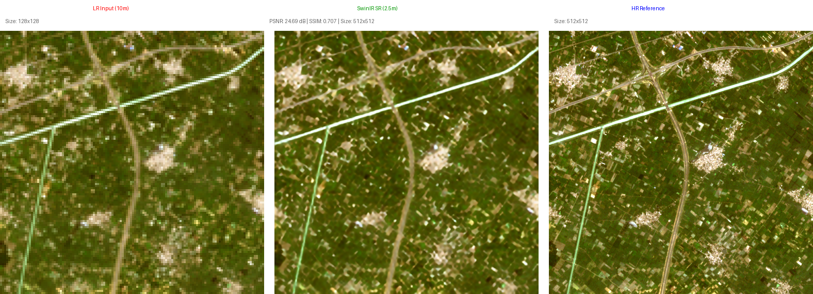
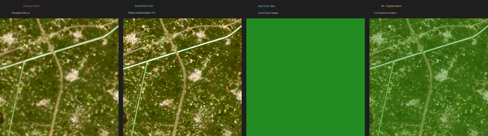
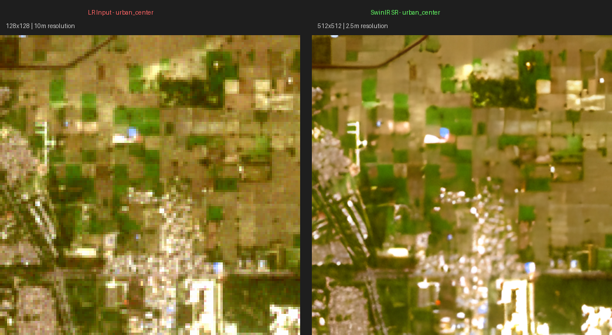
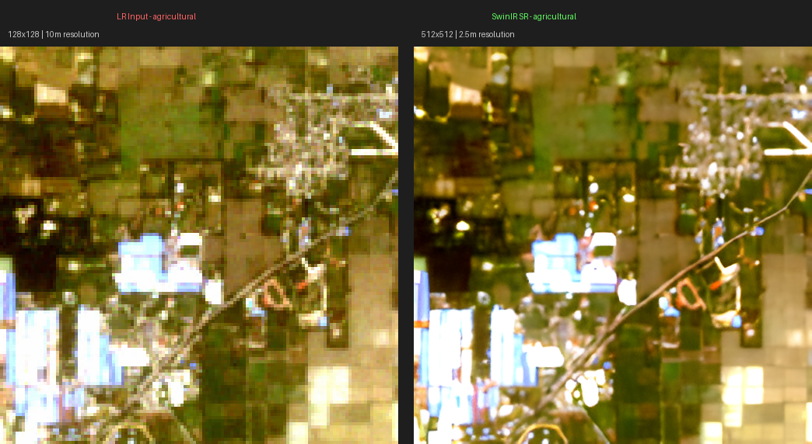
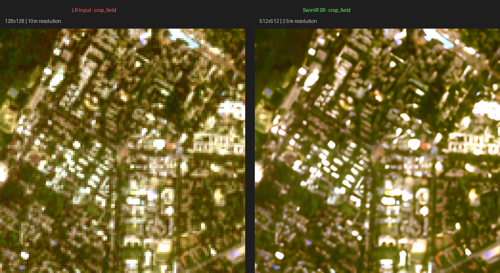
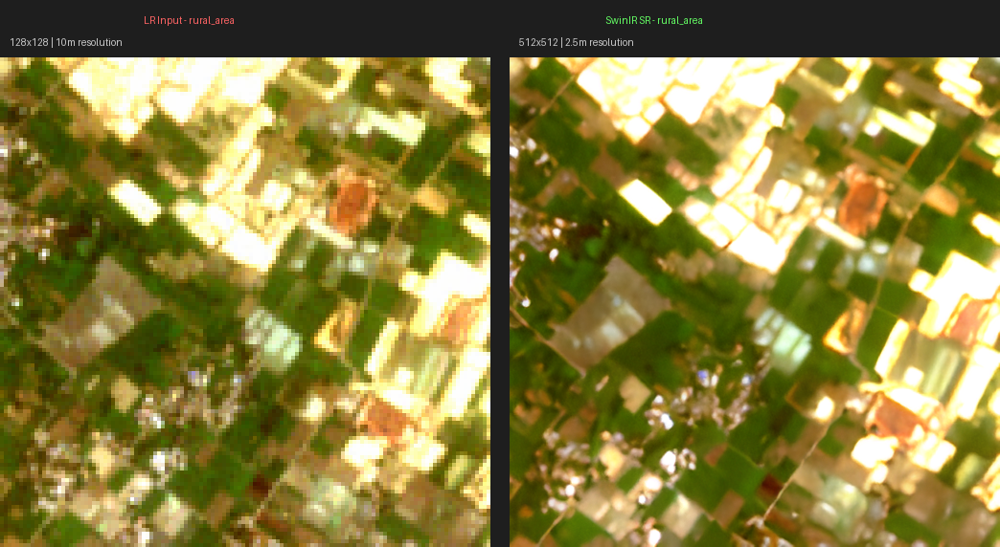
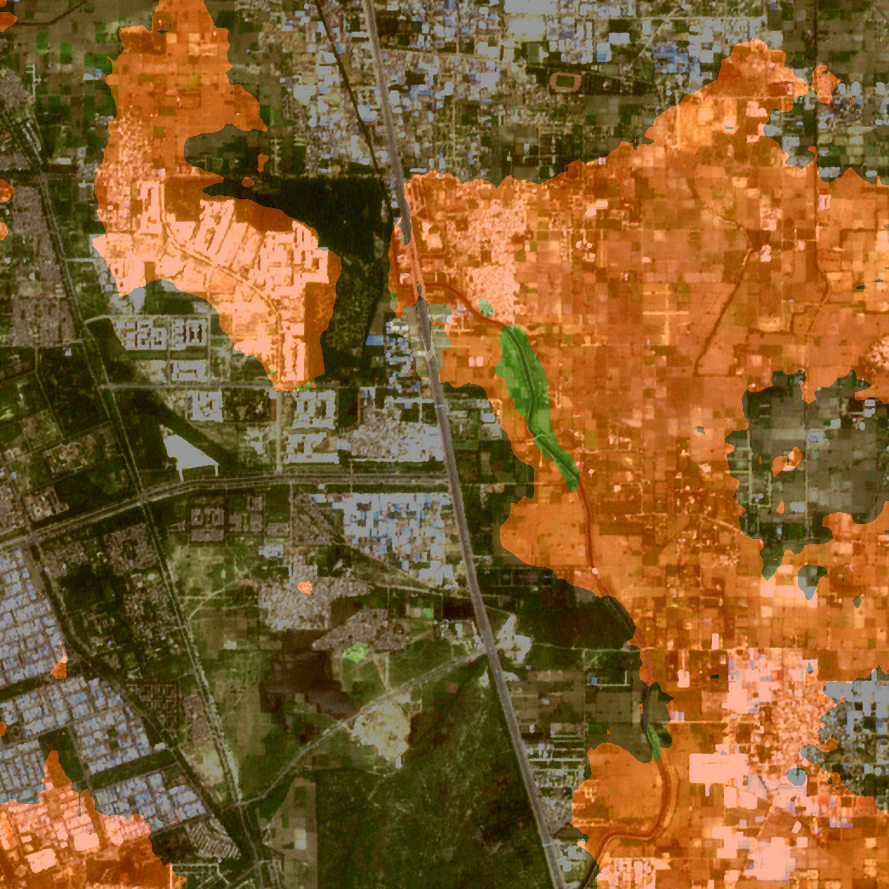

# 🛰️ Deep Learning Super Resolution Mapping (SRM)
### Experimental 4× Reconstruction and Land-Cover Mapping

[](https://www.ntro.gov.in)
[](https://python.org)
[](https://pytorch.org)
[](LICENSE)
[](https://www.nvidia.com)

> **SIH 2026 Project** | Problem Statement ID: **26142**
> **Organization:** National Technical Research Organisation (NTRO)

---

## 📋 Table of Contents

- [Overview](#-overview)
- [The Problem](#-the-problem)
- [Key Innovations](#-key-innovations)
- [Architecture](#️-architecture)
- [Dataset](#-dataset)
- [Results](#-results)
- [Visual Results](#️-visual-results)
- [Evaluation Metrics](#-evaluation-metrics)
- [Installation](#️-installation)
- [Usage](#-usage)
- [Project Structure](#-project-structure)
- [Tech Stack](#-tech-stack)
- [References](#-references)

---

## 🌍 Overview

India and global defense/research agencies rely on Sentinel-2 satellite imagery for agriculture monitoring, land-cover mapping, urban planning, disaster assessment, and environmental observation. However, at **10–30 metre resolution**, fine-scale details such as narrow roads, small buildings, field boundaries, and localized damage remain undetectable.

This project explores a **4× image reconstruction pipeline** for Sentinel-2 imagery using SwinIR, followed by SegFormer land-cover segmentation. A 10 m input is reconstructed on a grid with 2.5 m pixel spacing. This is a model-generated output, **not independently verified 2.5 m satellite information or a 2.5 m ground-truth product**. Training pairs are synthesized by downscaling Sentinel-2 imagery, so the evaluation does not establish recovery of real subpixel details.

---

## 🎯 The Problem

Without high-resolution satellite data:

- Fine-scale features (narrow roads, small buildings) are invisible
- Crop boundary detection is inaccurate
- Disaster damage assessment lacks spatial precision
- Urban mapping misses critical infrastructure details

Commercial high-resolution satellites (Pleiades, WorldView) are expensive and have limited coverage. Our approach **extracts more value from freely available Sentinel-2 data** using deep learning.

---

## 💡 Key Innovations
┌─────────────────────────────────────────────────────────────────┐
│ 1. SwinIR Transformer experiment using Sentinel-2 patches 	│
│ 2. 4× reconstruction: 10 m input → 2.5 m output grid 	│
│ 3. Synthetic LR-HR pair generation from single Sentinel-2 	│
│ 4. GAN-based perceptual training for sharp edge recovery 	│
│ 5. SegFormer land cover segmentation on SR output 		│
│ 6. Full end-to-end pipeline: Download → SR → Classify 	│
│ 7. Trained in 15 min on RTX 4050 (6GB VRAM) 			│
└─────────────────────────────────────────────────────────────────┘

---

## 🏗️ Architecture

### Complete Pipeline

```
Sentinel-2 L2A (10m)
        │
        ▼
┌─────────────────────┐
│   Preprocessing     │
│   Band selection    │
│   Normalization     │
│   Patch cropping    │
└──────────┬──────────┘
           │
           ▼
┌──────────────────────────────────────┐
│         SwinIR Transformer          	│
│                                     	│
│  Conv2d(3→180)  Shallow Features    	│
│         │                           	│
│         ▼                            │
│  ┌─────────────────────────────┐     │
│  │    6 × RSTB Block           │     │
│  │  Shifted Window Attention   │     │
│  │  window size = 8×8          │     │
│  │  LayerNorm + MLP (ratio=2)  │     │
│  └────────────┬────────────────┘     │
│               │                     	│
│               ▼                    	│
│  nearest+conv  4× Upsample          	│
└───────────────┬──────────────────────┘
                │
                ▼
      SR Output (4× reconstructed pixel grid)
                │
                ▼
┌──────────────────────────────────────┐
│         SegFormer-B2               	│
│   Pixel-wise Land Cover Map         	│
│   Green=Crops  │  Grey=Roads        	│
│   Red=Buildings│  Blue=Water        	│
└───────────────┬──────────────────────┘
                │
                ▼
       Final Segmentation Map
```

### SwinIR Model Details

### SwinIR Model Details

```
Input (128×128×3)
        │
        ▼
Conv2d(3 → 180)
← Shallow Feature Extraction
        │
        ▼
6 × RSTB Block
← Deep Feature Extraction
   ├── 6 × SwinTransformerBlock
   │     ├── Shifted Window Attention (window=8×8)
   │     ├── LayerNorm
   │     └── MLP (ratio=2)
   └── Conv2d(180→180)
        │
        ▼
LayerNorm + Conv
← Feature Fusion
        │
        ▼
nearest+conv Upsample 4×
← Reconstruction
        │
        ▼
Output (512×512×3)
```
---

## 📦 Dataset

Dataset: Sentinel-2 L2A (Copernicus Open Access)
─────────────────────────────────────────────────
Satellite : Sentinel-2C
Processing Level : L2A (Atmospherically Corrected; source files not included)
Tile : T43RGM (India Region)
Acquisition Date : July 2026
Spatial Resolution: 10 metres (R10m bands)
Bands Used : B02 (Blue), B03 (Green),
B04 (Red), B08 (NIR), TCI
Image Format : JP2 (JPEG 2000)

Synthetic Pair Generation:
─────────────────────────────────────────────────
HR patches : 512×512 (original Sentinel-2)
LR patches : 128×128 (4× bicubic downscale)
Training pairs : 160 (reported)
Validation pairs : 40 (reported; synthetic pairs)
Total patches : 200 (reported)

The source scenes and generated training patches are not included in this repository. HR targets are the original 10 m imagery; LR inputs are made by downscaling those targets 4×. The validation scores therefore measure reconstruction of these synthetic targets and should not be interpreted as independent validation against true 2.5 m imagery.

The checked-in segmentation scripts load a generic SegFormer model pretrained on ADE20K and apply a manually defined class-to-color mapping. They are illustrative outputs, not a custom land-cover model trained or validated for Sentinel-2.


---

## 📊 Results

### Training Performance

| Metric | Value |
|---|---|
| **Total Iterations** | 5,000 |
| **Training Time** | **15 min 41 sec** |
| **Hardware** | RTX 4050 6GB |
| **Initial Loss** | 0.084002 |
| **Final Loss** | 0.028249 |
| **Loss Improvement** | **66.4%** |

### Validation Metrics Over Training

| Checkpoint | PSNR (dB) | SSIM |
|---|---|---|
| 500 | 21.50 | 0.6302 |
| 1000 | 23.19 | 0.6548 |
| 2000 | 23.64 | 0.6736 |
| 3000 | 24.39 | 0.6979 |
| 4000 | 24.48 | 0.6952 |
| **5000** | **24.69** | **0.7073** |

### Reported Evaluation (40 Synthetic Validation Patches)

| Metric | Score | Interpretation |
|---|---|---|
| **PSNR** | **24.66 dB** | Good reconstruction quality |
| **SSIM** | **0.7386** | Strong structural similarity |
| **LPIPS** | **0.3718** | Good perceptual quality (↓ better) |

---

## 🖼️ Visual Results

### LR vs SwinIR SR vs HR Comparison


### Complete Pipeline — 4 Panel Result


### Multiple Terrain Types

| Urban Center | Agricultural |
|---|---|
|  |  |

| Crop Field | Rural Area |
|---|---|
|  |  |

### Segmentation Map


---

## 🛠️ Installation

The checked-in demo opens the result images already in `results/`; it does not run inference. Training imagery, trained model weights, and the external SwinIR/BasicSR source repositories are not included. The helper scripts still contain original-machine paths and need those paths and external artifacts configured before they can run end-to-end.

### Step 1 — Clone Repository

```bash
git clone https://github.com/Anandraj239/SRM-Sentinel2-SuperResolution.git
cd SRM-Sentinel2-SuperResolution
```

### Step 2 — Create Conda Environment

```bash
conda create -n srm python=3.10 -y
conda activate srm
```

### Step 3 — Install Python Dependencies

```bash
pip install -r requirements.txt
```

For GeoTIFF/JP2 dataset preparation, install Rasterio and its native dependencies from conda-forge if pip installation fails:

```bash
conda install -c conda-forge rasterio gdal -y
```

### Install CUDA-enabled PyTorch (optional)

```bash
pip install torch==2.6.0 torchvision==0.21.0 --index-url https://download.pytorch.org/whl/cu124
```

The CPU build is sufficient to run `demo.py`; CUDA is needed only for GPU inference or training. Training also requires a compatible SwinIR/BasicSR checkout, Sentinel-2 scenes, and model weights. This repository does not include a runnable BasicSR training configuration or those external artifacts.

### Verify GPU setup

```bash
python -c "import torch; print(torch.cuda.is_available()); print(torch.cuda.get_device_name(0))"
```

---

## 🚀 Usage

### Browse the included results

```bash
conda activate srm
python demo.py
```

Use `python demo.py --no-open` to list available result files and print the checked-in metrics without opening images. These files are precomputed examples; the demo does not download data, load model weights, or run the SR/segmentation models.

---

## 📁 Project Structure

```
SRM-Sentinel2-SuperResolution/
│
├── 📂 scripts/
│   ├── prepare_dataset.py          # Create LR-HR pairs from Sentinel-2
│   ├── full_inference.py           # End-to-end SR + Segmentation
│   ├── segformer_inference.py      # SegFormer land cover mapping
│   ├── calculate_metrics.py        # PSNR, SSIM, LPIPS evaluation
│   ├── compare_results.py          # LR vs SR vs HR comparison
│   ├── final_comparison.py         # 4-panel pipeline result
│   ├── training_summary.py         # Training statistics report
│   ├── visualize.py                # Sentinel-2 visualization
│   └── crop_patch.py               # Patch extraction
│
├── 📂 results/
│   ├── comparison_result.png       # LR vs SR vs HR (3-panel)
│   ├── final_pipeline_result.png   # Full pipeline (4-panel)
│   ├── sentinel2_SR_output.png     # Full SR output image
│   ├── metrics_report.txt          # Quantitative metrics
│   ├── metrics_report.txt          # Reported metrics on synthetic pairs
│   ├── 📂 patches/
│   │   ├── urban_center_comparison.png
│   │   ├── agricultural_comparison.png
│   │   ├── crop_field_comparison.png
│   │   ├── mixed_land_comparison.png
│   │   ├── rural_area_comparison.png
│   │   └── outskirts_comparison.png
│   └── 📂 segmentation/
│       ├── sentinel2_segmentation.png
│       └── sentinel2_overlay.png
│
├── demo.py                         # Opens the checked-in result images
├── requirements.txt                # pip dependencies
├── .gitignore
└── README.md
```

---

## 💻 Tech Stack

```
┌─────────────────┬──────────────────────────────────────────────┐
│ Category        │ Tools / Libraries                            │
├─────────────────┼──────────────────────────────────────────────┤
│ Language        │ Python 3.10                                  │
│ Deep Learning   │ PyTorch 2.6.0+cu124                          │
│ SR Model        │ SwinIR-Medium (11.7M parameters)             │
│ Segmentation    │ SegFormer-B2 (HuggingFace Transformers)      │
│ Training FW     │ BasicSR 1.4.2 (external dependency)           │
│ GIS / Remote    │ GDAL, Rasterio, Pyproj, Shapely              │
│ Visualization   │ Matplotlib, OpenCV, PIL                      │
│ Metrics         │ LPIPS, scikit-image (PSNR/SSIM)              │
│ GPU / Hardware  │ NVIDIA RTX 4050 Laptop (6GB VRAM)            │
│ CUDA            │ 12.4 / PyTorch cu124                         │
│ Data Source     │ ESA Copernicus Browser (Sentinel-2 L2A)      │
│ OS              │ Windows 11                                   │
└─────────────────┴──────────────────────────────────────────────┘
```


---

## 📚 References

1. Liang et al. (2021). **SwinIR: Image Restoration Using Swin Transformer.** ICCV 2021. [arXiv](https://arxiv.org/abs/2108.10257)
2. Xie et al. (2021). **SegFormer: Simple and Efficient Design for Semantic Segmentation with Transformers.** NeurIPS 2021. [arXiv](https://arxiv.org/abs/2105.15203)
3. Wang et al. (2021). **Real-ESRGAN: Training Real-World Blind SR with Pure Synthetic Data.** ICCV 2021. [arXiv](https://arxiv.org/abs/2107.10833)
4. ESA Copernicus. **Sentinel-2 MSI Level-2A Dataset.** [browser](https://browser.dataspace.copernicus.eu)
5. Salgueiro et al. (2022). **Super-Resolution of Sentinel-2 Imagery Using GANs.** Remote Sensing, MDPI. [DOI](https://doi.org/10.3390/rs14092181)
6. Dong et al. (2016). **Image Super-Resolution Using Deep CNNs (SRCNN).** IEEE TPAMI. [arXiv](https://arxiv.org/abs/1501.00092)
7. Garnot et al. (2021). **Panoptic Segmentation of Satellite Image Time Series.** ICCV 2021. [arXiv](https://arxiv.org/abs/2107.07461)
  
---

**Anand Raj**
B.Tech CSE (AI & ML)
